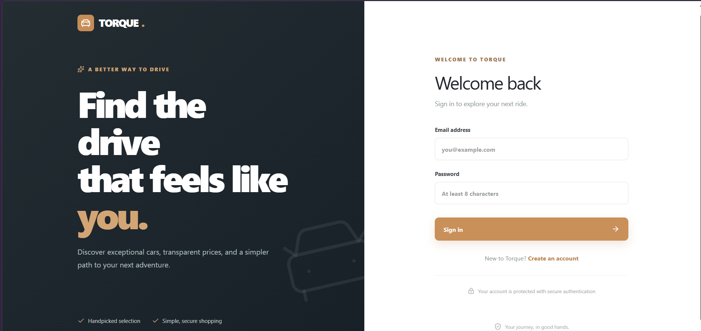
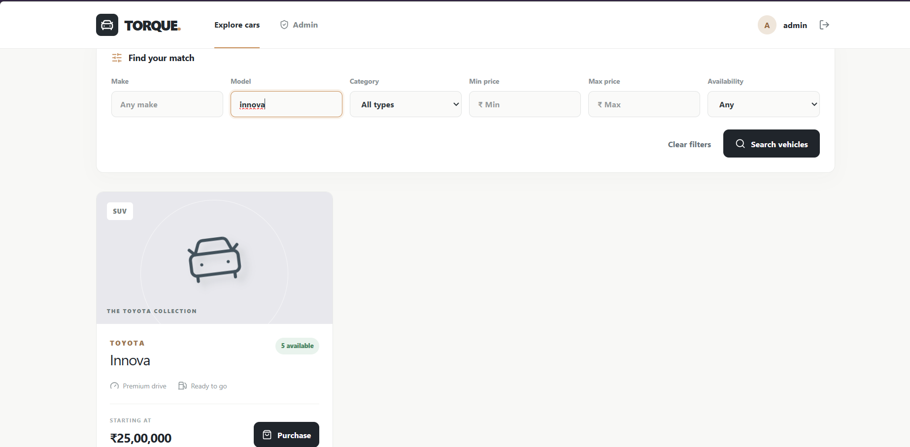
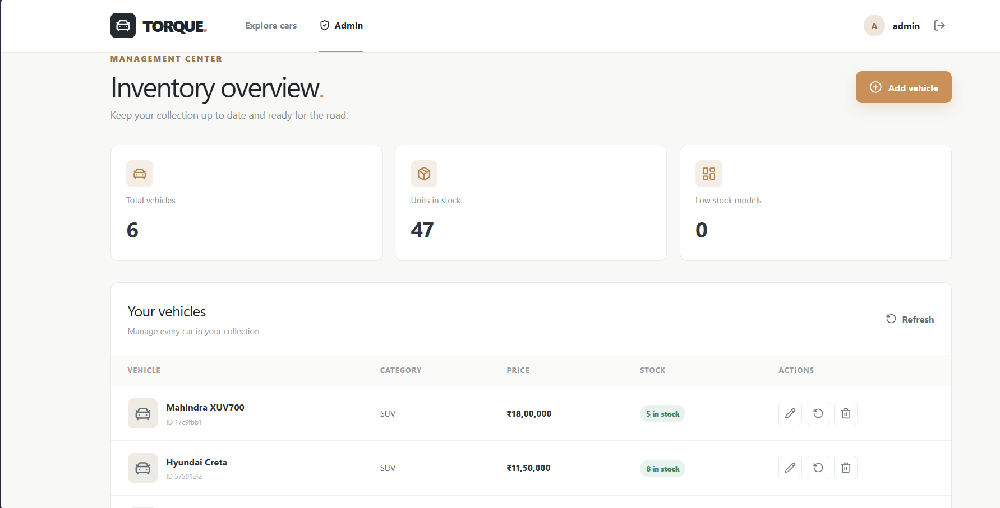
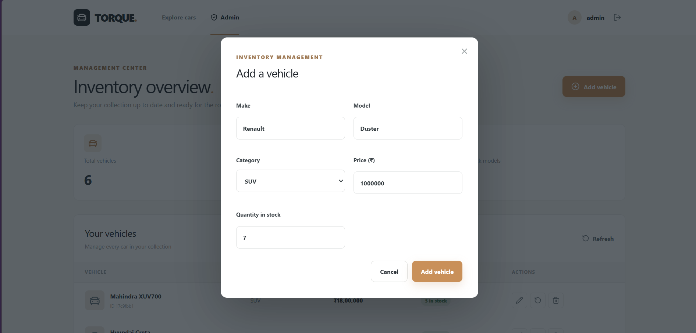
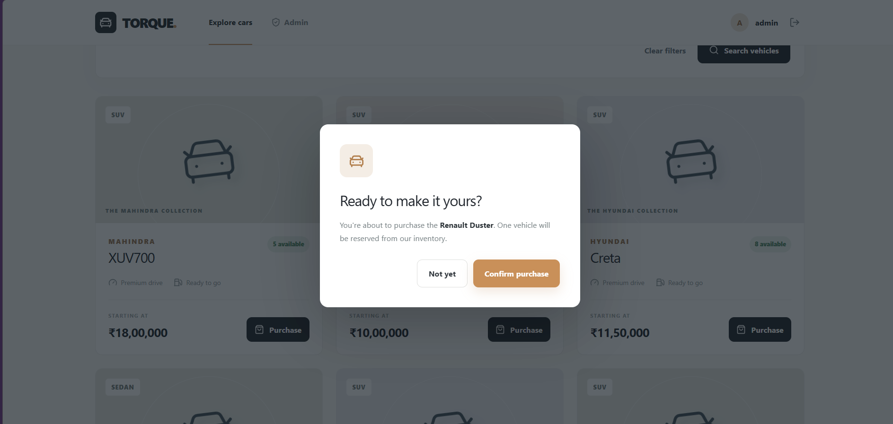

# 🚗 TORQUE — Car Dealership Inventory System

**A full-stack Car Dealership Inventory System developed for the Incubyte TDD Kata assignment.**

Built with React, Node.js, Express, PostgreSQL, Prisma, and Test-Driven Development.

### 🌐 Live Application

**[Click Here to Launch TORQUE](https://car-dealership-tdd-kata.vercel.app)**

### Application Screenshots

**Vehicle Dashboard**

**Search and Filtering**

**Admin Dashboard**

**Add Vehicle**

**Vehicle Purchase**

### Key Features

- User registration and JWT-based login.
- Vehicle browsing with search and filtering.
- Vehicle purchasing with stock updates.
- Admin-only vehicle creation, editing, and deletion.
- Inventory restocking.
- PostgreSQL persistence using Prisma ORM.
- Automated tests following Red-Green-Refactor.

### Technology Stack

**Frontend:** React, Vite, Tailwind CSS  
**Backend:** Node.js, Express  
**Database:** PostgreSQL, Prisma ORM  
**Authentication:** JWT, bcrypt  
**Testing:** Jest, Supertest  
**Deployment:** Vercel, Render, Neon

### Test-Driven Development

The backend was developed using the **Red-Green-Refactor** approach.

See [TEST_REPORT.md](TEST_REPORT.md) for recorded test execution results and coverage.

### AI Usage

See the detailed **My AI Usage** section and [PROMPTS.md](PROMPTS.md) for AI assistance documentation.
